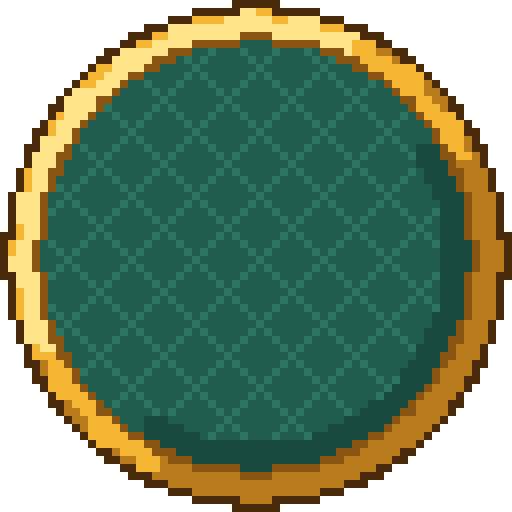
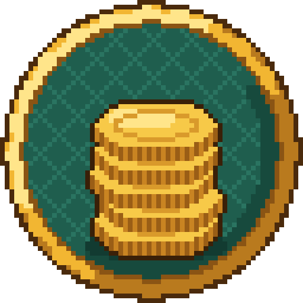

# CapitalEngine brand kit

Every CapitalEngine plugin, and any add-on that wants to look like part of the family, uses the same **frame** with its own **emblem** in the middle. The frame says "this is CapitalEngine"; the emblem says which plugin it is.

| Frame template | CapitalEngine (core) |
|---|---|
|  |  |

## Files
| Path | What |
|---|---|
| `src/frame.aseprite` | The frame on its own (layer `frame`). Start every new icon from a copy of this. |
| `src/core.aseprite` | CapitalEngine's icon: layers `frame` and `emblem`. |
| `icons/<name>-64.png` | The pixel-exact icon. |
| `icons/<name>-512.png` | The same, scaled 8x with nearest-neighbour, for Modrinth, Hangar, CurseForge and GitHub. |

## The frame
- **64 x 64 pixel art**, a gold coin seen from the front: a 1 px dark outline, a 3 px gold rim with a milled edge, and a thin dark inner ring.
- **Inside:** banknote green with a diagonal lattice, darker toward the lower right.
- **Light comes from the top left.** The rim is lighter there and darker at the bottom right.
- **Don't change the frame.** It is identical on every icon; that is what makes the family recognisable.

## The emblem
- **One object**, drawn as if seen from slightly above, that names the plugin at a glance: a stack of coins for core, a market stall for Market, and so on.
- **Fits inside the central 36 x 32 px**, roughly x 14–50 and y 18–54, so it never touches the rim.
- **1 px outline in `#3A2008`** around the outside, the same light from the top left, and a soft ellipse shadow `#123B31` on the floor of the frame.
- **Warm colours** (gold, wood, red, orange) so the emblem stands out from the green. If you need blue or green, keep them much lighter or darker than the background.
- **Pixel art rules:** no anti-aliasing, no gradients, no lone pixels, and at most about 16 colours in the whole icon.

## Palette
| Use | Colours |
|---|---|
| Frame gold, light to dark | `#FFE58A` `#F2B632` `#B97A1E` `#8A5414`, outline `#4A2A0C` |
| Frame green | `#2A7461` lattice, `#1F5E4E` base, `#174A3D` shade, `#123B31` emblem shadow |
| Coin gold (emblems) | `#FFE58A` `#F7C948` `#D99A2B` `#C98422` `#9A5E16`, outline `#3A2008` |

## Planned emblems
| Plugin | Emblem |
|---|---|
| CapitalEngine (core) | A stack of coins (done) |
| CapitalMarket | A market stall with a striped awning |
| CapitalBank | A round vault door |
| CapitalDashboard | A small screen showing a rising chart |
| CapitalTrade | A ship's anchor, or a crate on a dock |

## Using the style for your own add-on
**Proposed. The owner has not decided yet.**

- **Free to use:** the frame template, the palette and this guide, under **CC BY 4.0**. Make your own emblem, put it in the frame, and credit "Frame by the CapitalEngine project".
- **Reserved:** the CapitalEngine name, the official emblems and the official icons (core, Market, Bank, Dashboard, Trade) are not under the GPL or CC BY. Don't use them as your own add-on's icon.
## Naming your add-on
Any add-on, official or not, may be called `Capital<Word>` (for example CapitalAuctions or CapitalQuests), as long as:

1. **It says it is unofficial.** Your project page and README must carry this statement, or one with the same meaning:
   > This project is not associated or affiliated with CapitalEngine or its owners, Heet Patel and Patel's Labs.
2. **It doesn't reuse an official plugin's name.** These belong to the official plugins: CapitalEngine, CapitalMarket, CapitalBank, CapitalDashboard and CapitalTrade, plus the planned official add-ons in [Plan.md §11](../Plan.md) (CapitalBusiness, CapitalStocks, CapitalBanks+, CapitalBonds, CapitalCash, CapitalNations, CapitalTax and CapitalCredit). The list grows as official add-ons are added.
